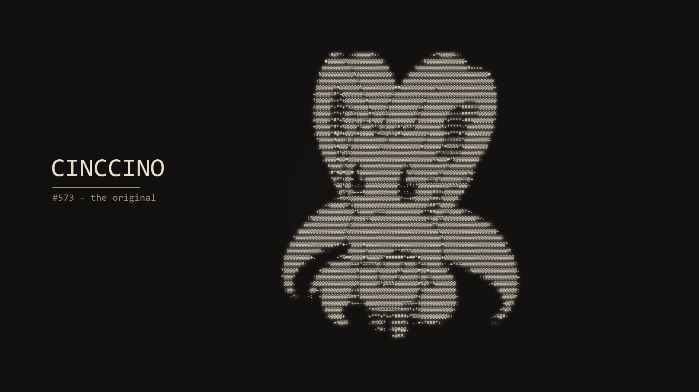
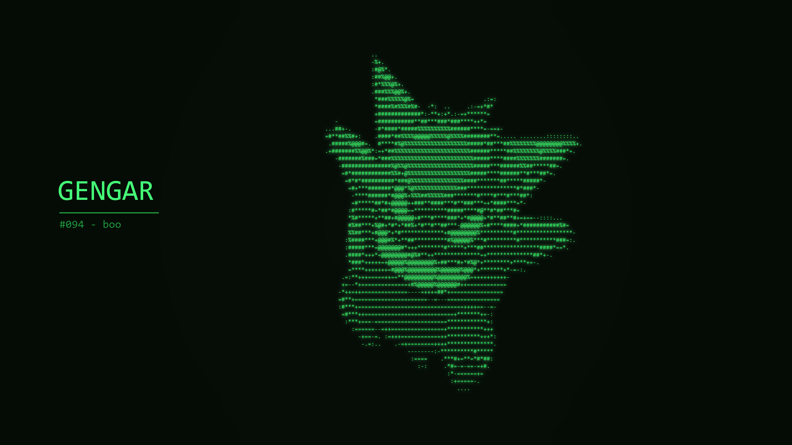

# ascii-mon studio

turns pokemon into ascii art wallpapers. type a name, pick a color, hit set as wallpaper. made this because my desktop needed a cinccino on it.



## what it does

- any of the 1025 pokemon, by name or dex number (data comes from pokeapi)
- 16 color styles, including game boy and matrix green
- detail slider, from chunky retro characters to a finer grid, always reads as ascii
- custom subtitle line under the name
- favorites and recents, remembered between sessions
- surprise me button for random rolls
- dark and light mode for the app itself



## running it

windows user? grab the exe from the [releases page](https://github.com/Alvenzz/ascii-mon-studio/releases) and skip everything below.

otherwise: needs python 3.9+. windows for the wallpaper part (it's a win32 call), the generation itself runs anywhere.

```
pip install -r requirements.txt
python ascii_mon_app.py
```

wallpapers land in Pictures/ASCIImon and artwork gets cached in art/, so the second time you generate the same pokemon it's instant.

## how it works, briefly

grabs the official artwork, converts it to a grid of characters based on brightness (`.:-=+*#%@`), renders that with a monospace font onto a 1920x1080 canvas, then sets it as your wallpaper with SystemParametersInfo. that's it.

## license

MIT. pokemon belongs to nintendo/creatures/game freak, this is just a fan tool that pulls sprites from [PokeAPI](https://github.com/PokeAPI/sprites).
